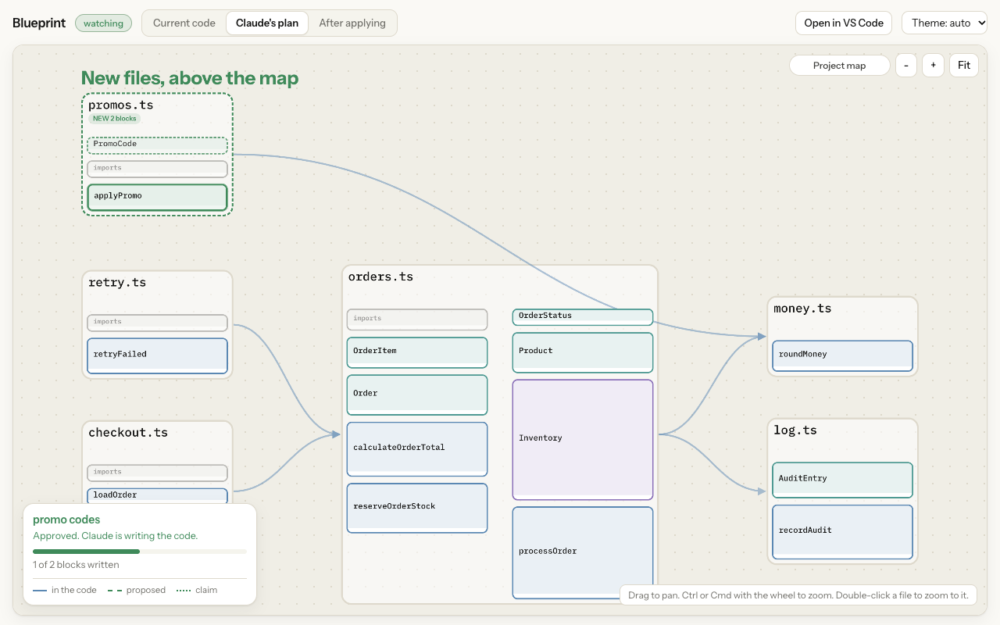

<h1 align="center">Blueprint</h1>

<p align="center">
  A live map of your real code. Plan a feature on it before it is built, then check what actually got built.
</p>

<p align="center">
  <a href="https://github.com/jgonzaludo/code-blueprint/actions/workflows/ci.yml"></a>
  <a href="LICENSE"></a>
  
</p>

<p align="center">
  
</p>

## Why this exists

We saw some dude making a waitlist, presumably to sell it. We thought it was a good idea too so here it is open source.

## What it is

Blueprint turns a TypeScript or JavaScript project into a zoomable map. Zoomed out you see files and the arrows between them. Zoom in and you see the exact code, line for line, with an arrow from every call to the thing it calls.

It is built to sit next to an AI coding session:

- **Ask about code.** "What does this file do?" is answered from the parser, not guessed.
- **Plan before you build.** A feature shows up as dashed blocks and arrows on the map before a line is written.
- **Check after.** Each planned arrow is marked confirmed, or not in the code. Anything the code added that nobody planned is flagged.
- **Watch it live.** The map follows your files as they change.

The parser produces every block, line and solid arrow as fact. The model only plans and narrates, and anything it claims is drawn dashed until the parser confirms it. Everything runs on your machine.

## Quick start

```bash
git clone https://github.com/jgonzaludo/code-blueprint.git
cd code-blueprint
pnpm install && pnpm -r build
pnpm demo
```

`pnpm demo` makes a throwaway project with a feature drafted as a plan, and opens the map. Needs Node 20 or later and pnpm.

On your own project:

```bash
cd your-project
node /path/to/code-blueprint/packages/cli/dist/cli.js          # opens the live map
node /path/to/code-blueprint/packages/cli/dist/cli.js print src/index.ts
```

Blueprint is not on npm yet. Once it is, this becomes `npx code-blueprint`.

## Use it with Claude

```bash
blueprint skill install            # for you, in ~/.claude/skills
blueprint skill install --project  # for this repo only, so a team shares it
```

Or as a plugin: `/plugin marketplace add jgonzaludo/code-blueprint`, then `/plugin install blueprint@code-blueprint`.

Then just ask. "What does `src/orders.ts` do?" answers from `print`. "Add refund support" makes Claude put the plan on the map, wait for your go, apply it, and report how many planned arrows were confirmed. In plan mode the proposed blocks appear on the map as Claude plans, and in auto mode you watch them turn solid as the code lands. The window is read only: you answer in chat.

In the Claude desktop app the map opens in the built-in browser pane next to the chat.

## Commands

| Command | What it does |
|---|---|
| `blueprint` / `blueprint watch` | Serve the live map on `127.0.0.1` and follow your files. |
| `blueprint print <file\|dir>` | Entry points and what they call, as a text tree. `--json`, `--depth 2`. |
| `blueprint plan new\|add\|sketch\|claim\|ready\|approve\|changes\|apply` | Draft a feature as files or sketches and move it through review. |
| `blueprint check` | After applying: confirmed, missing and unplanned arrows. |
| `blueprint snapshot` | One self-contained HTML file of the map. Works offline, no server. |
| `blueprint skill install\|status\|print` | Install the Claude skill, check it is current. |

Add `--include-tests` if you want test files on the map (they are skipped by default). Run `blueprint --help` for everything.

## How it works

1. The TypeScript compiler API parses your project into blocks (functions, classes, types) and the calls between them.
2. A plan is a set of draft files or intent-only sketches, parsed as an overlay on your real files. Nothing touches your project until you apply it.
3. After applying, the parser re-reads the real code and compares it to the plan.
4. A small local server (127.0.0.1 only, token protected, read only) pushes updates to the page over server-sent events.

More detail, and every design decision, is in [docs/CONTEXT.md](docs/CONTEXT.md).

## Limits

Blueprint says what a static parser can't see rather than guessing:

- Calls through `any`, string-keyed access and DI containers can't be resolved.
- Interface method calls point at the interface, not the implementations.
- Only TypeScript and JavaScript for now.
- Very large files (over 5,000 lines) and minified code are skipped.

## Develop

```bash
pnpm install
pnpm -r build
pnpm test        # unit, integration and real-browser tests
pnpm lint
```

Commits and PR titles follow [Conventional Commits](CONTRIBUTING.md). There is a by-hand testing checklist in [docs/TESTING.md](docs/TESTING.md).

## License

MIT
