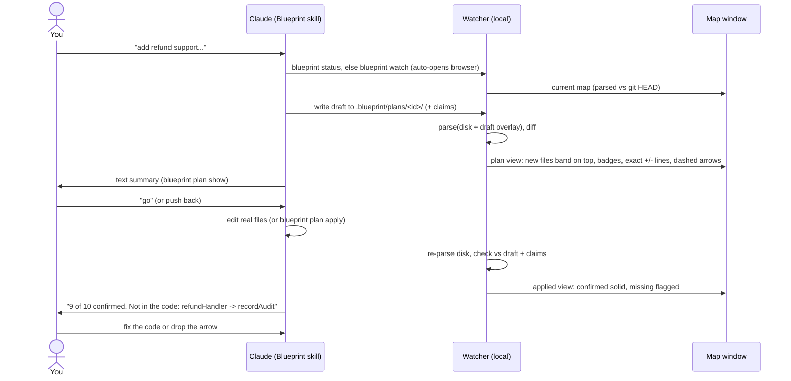
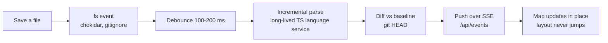
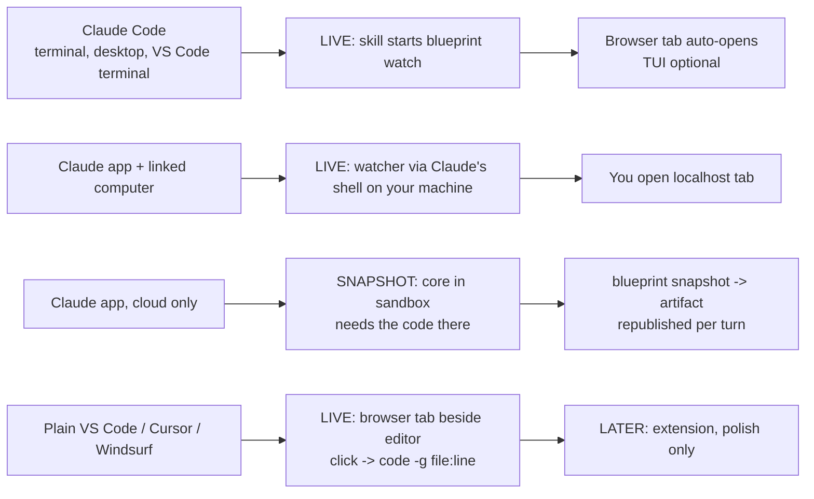
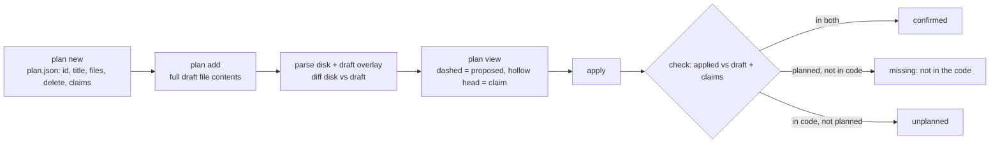
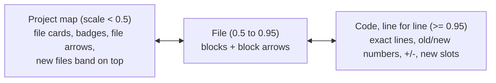
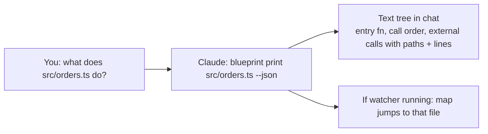

# Blueprint user flows (text versions)

These are the same flows as the PNGs in `flows/`, written as text and mermaid so they can be read without the images. `docs/CONTEXT.md` has the full detail. The section numbers below point into it.

## F1. Draft a feature with Claude (main flow, CONTEXT 4.2 and 9)

Arrow states: same (solid neutral), proposed (dashed green), confirmed (solid green), missing / "not in the code" (red dashed), unplanned (amber), claim (dashed, hollow arrowhead).

## F2. Live while editing (CONTEXT 4.3 and 10.2)

## F3. Which surface where (CONTEXT 5)

## F4. Plan protocol and check (CONTEXT 9)

## F5. Semantic zoom (CONTEXT 11.1)

## F6. Ask about code (CONTEXT 4.1)

